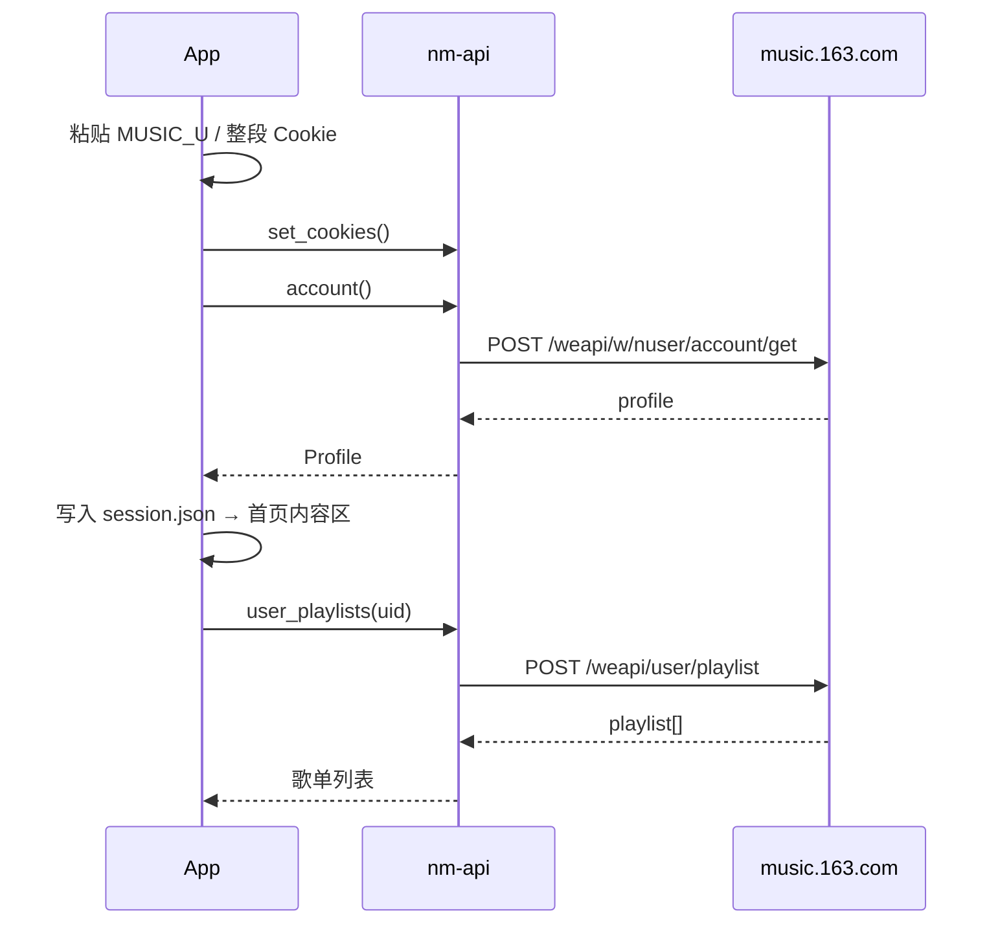

# Montis（山音）

Montis（中文名：山音）是一个用 Rust 编写的第三方桌面音乐客户端，基于 **iced 0.13 + wgpu**。
网易云音乐提供歌单 / 搜索 / 每日推荐 / 私人 FM / 歌手页，哔哩哔哩提供收藏夹纯音频播放。
界面采用浅色卡片布局，播放页带环形实时频谱与粒子效果。支持 Cookie 登录、本地收藏、歌曲下载与
本地音乐文件夹、音频与封面缓存，以及可调的频谱可视化。

> **当前仅面向 Linux 桌面**（X11 / Wayland），要求 Rust 1.80 及以上版本。

## 名字的由来

「Montis」取自拉丁语 `mons`（山）的属格 `montis`，中文名便叫「山音」。

我一直希望有这样一个软件：它安静地陪着你听歌，不打扰、不催促，像一座山把现实里的烦躁隔在外面。
山的那边是日常的喧嚣，山的这边只有属于你自己的音乐。

「山音」既是山里的声音，也是山一样沉稳的陪伴。不必热闹，安安静静地听就好。

## ⚠️ 免责声明（叠甲）

> **本项目仅供个人学习、研究与技术交流使用，严禁用于任何商业用途。**

1. **非官方项目**：本项目与网易云音乐及其关联公司没有任何关系，不代表其立场，也未获得其授权、
   认可或赞助。项目名称、商标及相关权益归各自权利人所有。
2. **仅作学习研究**：本项目用于学习 Rust、iced、音频可视化与网络协议等技术的实践，
   不提供、不托管、不传播任何音乐、歌词、封面等受版权保护的内容。
3. **接口来源**：所有数据均来自公开的网易云音乐 / 哔哩哔哩 Web 端接口，可能随时调整、失效或触发风控。
   使用即表示你同意自行遵守对应平台的用户协议及所在地法律法规。
4. **下载功能**：仅用于个人已获授权内容的离线收听，请勿用于复制、传播、出售或再分发受版权保护的作品。
5. **账号安全**：登录仅使用你自己提供的 Cookie，程序不接触、不保存密码；Cookie 以 `0600` 权限保存在本地。
6. **自担风险**：使用本项目产生的任何后果（包括但不限于账号风控、数据丢失、法律风险）均由使用者自行承担。
7. **权利通知**：如权利人认为本项目侵犯其权益，请通过仓库 issue 联系维护者，我们会及时处理。

## 功能

### 账号与资料

- **Cookie 登录**：没有账号时也会直接进入带侧边栏的主界面，两个渠道的登录页都嵌在内容区：
  网易云在「网易云音乐」分组点「登录」，哔哩哔哩在「BiliBili」分组点「连接」。
  两者使用同一套卡片布局与步骤说明，只是配色与凭证不同，互不影响。
  网易云对扫码登录的风控较严，界面暂不展示二维码（`nm-api` 仍保留相关实现）。
- **只登录哔哩哔哩**：不登录网易云也能进入主界面，启动后默认打开哔哩哔哩分区；
  歌单、搜索、每日推荐与私人 FM 会提示先登录网易云，哔哩哔哩收藏夹不受影响。
- **会话恢复**：启动时用本地 Cookie 校验登录态；网易云失效但哔哩哔哩仍有效时，
  可以从侧边栏的哔哩哔哩账号卡直接进入。
- **资料展示**：侧边栏按渠道展示账号卡——「网易云音乐」分组下是网易云头像、昵称与 UID，
  「BiliBili」分组下是 B 站头像、昵称与 UID；未连接时卡片本身就是登录入口。
  签名、等级、VIP 与关注 / 粉丝数等字段目前不在界面展示。
- **本地会话**：网易云 Cookie 与资料写入 `~/.config/melody/session.json`，
  哔哩哔哩写入 `~/.config/melody/bilibili.json`，Unix 权限均为 `0600`。

### 浏览与搜索

- **我的歌单**：首页卡片展示创建 / 收藏的歌单，支持刷新；标题与「全部歌单」行固定，
  只有歌单网格滚动。
- **首页快照**：上次加载到的歌单列表会写入 `~/.config/melody/library.json`，启动时先摆出来
  （封面直接读本地缓存），网络刷新在后台进行；快照带账号 ID，换账号后旧快照会被忽略。
  在设置页「清空缓存」时，这份快照也会一并删除。
- **歌曲搜索**：侧边栏「搜索」进入独立页面；`cloudsearch` 搜索歌曲，结果带封面、歌手、专辑与时长；
  每页 100 首，标题显示「已加载 / 总数」，列表底部可「加载更多」；搜索框与结果标题固定，只有结果列表滚动。
- **每日推荐**：拉取账号的每日推荐歌曲（`/weapi/v1/discovery/recommend/songs`），
  可直接播放或添加到下一首，每次进入都会重新获取；表头固定，只有歌曲列表滚动。
- **私人 FM**：按账号口味持续推荐（`/weapi/v1/radio/get`；接口每次只给 3 首，页面一次合并 12 首），
  支持播放全部、单曲播放、添加到下一首与「换一批」。从 FM 开始播放后，队列播到队尾会自动续上新一批；
  切到普通歌单则恢复普通队列行为。
- **歌手页**：在搜索结果 / 歌单 / 每日推荐 / 私人 FM / 正在播放页点击作者名进入；
  头像、别名 / 作品数与简介固定在顶部（长简介可展开 / 收起），下方是热门歌曲与「加载更多」；
  支持播放全部、单曲播放与添加到下一首。从播放页进入时，返回会回到播放页。
- **歌单详情**：固定标题卡（平铺淡蓝底、播放全部 / 随机播放）、创建者、简介与带专辑封面的歌曲列表，
  列标题固定在滚动区外。歌曲列表按行虚拟化，只渲染可见的几十行，几千首也不卡；
  详情接口只返回前 1000 首，剩下的用 `trackIds` 在后台分批补齐，封面随滚动按需加载。

### 收藏

- **本地红心收藏**：歌曲行、播放队列、底部播放条与正在播放页都有红心按钮；
  收藏只保存到本地 `~/.config/melody/liked.json`，不写入网易云，也不受云端风控影响。
  红心状态在启动时直接从本地恢复，切换账号或退出登录不会清空。
- **我喜欢的音乐**：侧边栏独立页面，支持播放全部、随机播放与按行虚拟化；标题卡用账号头像作封面。
  首页「全部歌单」里的「我喜欢的音乐」仍是云端歌单，只用于查看与播放云端收藏，不会与本地收藏混在一起。
- **导入 / 导出**：收藏页可以把这份列表备份成 JSON（默认 `~/.config/melody/liked-export.json`，
  可改路径，支持 `~/`）；导入时与现有收藏合并、自动跳过已收藏的歌，也接受裸歌曲数组格式。

### 哔哩哔哩收藏夹

- **独立分区**：侧边栏「BiliBili」与网易云互不影响。点「BiliBili」分组里的连接卡，
  内容区会显示独立的哔哩哔哩登录页（与网易云登录页同布局、粉色主题），
  粘贴 `SESSDATA` 或整段 Cookie 即可连接；也可以直接点「粘贴」读取剪贴板。
  登录态单独保存在 `~/.config/melody/bilibili.json`（权限 600）。
- **收藏夹列表**：读取账号创建 / 默认收藏夹，展示封面、视频数与公开 / 私密状态。
- **纯音频播放**：收藏夹内容按视频分页加载（每页 20 条，底部「加载更多」），
  直接取 DASH 音轨，不打开视频页、不下载视频流；按接口返回的最高码率播放
  （64K / 132K / 192K / 杜比 / Hi-Res）。
- **完整复用播放器**：播放全部、随机、下一首、红心、下载、队列与本地缓存与网易云歌曲一致；
  B 站音源不参与网易云的音质档位，切换音质不会重复下载。

### 播放

- **基础播放**：点歌即播，支持播放 / 暂停、上一首 / 下一首、拖动进度、调节音量、自动续播队列。
- **随机与循环**：播放条、正在播放页与队列面板都可以切换随机（左边开关）与循环
  （顺序 / 列表循环 / 单曲循环）；两者独立生效，随机模式按播放历史回退上一首。
  手动上一首 / 下一首优先于循环规则：单曲循环下也能正常切歌（队尾回到队首），
  开了随机时下一首就走随机；只有自动续播时才是「单曲循环 > 随机」。
- **音量**：不占位置，点击音量图标快速静音 / 恢复，鼠标悬停时滚动滚轮可微调音量。
- **状态恢复**：关闭应用后再打开，底部播放条会恢复上次的队列、歌曲、进度、模式、音量与音质（保持暂停）。
- **不可播处理**：非 VIP 账号遇到需要 VIP / 购买 / 无版权的歌曲时不报错，会直接切到下一首，
  并在底部弹出「已自动跳过」的悬浮提示；连续 5 首不可播时会停下并说明原因。
- **音质**：点击底部播放条或正在播放页的音质胶囊，弹出居中选择窗：
  标准 / 较高 / 极高 / 无损 / Hi-Res；切换后按原进度重新加载当前曲目。
  请求档位可能被接口降级，此时胶囊旁会标注实际音源。选择会随播放状态一起保存。
- **播放队列**：底部与正在播放页可打开队列面板，查看、跳播、移除与清空；随机与循环可以自由组合；
  关闭再打开会回到上次滚动到的位置。歌曲行最右的 ＋ 是「添加到下一首」：
  插到当前播放项之后，连续添加时后加的排得更靠前（A 播放中，先加 H 再加 K → A K H B C），并弹出提示。

### 本地音乐与缓存

- **歌曲下载**：歌曲行、底部播放条与正在播放页都有下载按钮（↓）。
  下载按当前音质保存到数据目录 `~/.local/share/melody/music/`，和播放缓存分开存放：
  清空缓存、缓存上限淘汰都不会删除。最多同时下载 2 首，其余排队；重复点击会提示
  「已在本地音乐中」或「正在下载」。下载中显示三点动画，完成显示对勾；
  VIP / 无版权歌曲会提示原因，写入采用临时文件 + 重命名，不会留下半截文件。
- **本地音乐页**：侧边栏「本地音乐」是独立页面，支持播放全部、随机播放、按行删除（仅下载曲目）
  与「清空下载」（弹窗确认，只删除下载的歌曲，不影响音乐文件夹）。下载曲目显示实际音质与文件大小，
  文件夹曲目显示格式与大小；播放时优先读本地文件，断网也能听。
- **音乐文件夹**：「文件夹」可以添加任意本地目录（列表保存在 `~/.config/melody/music-folders.json`），
  递归扫描 mp3 / flac / wav / ogg / oga / m4a / aac，读取 ID3 / Vorbis 标签与内嵌封面
  （没有内嵌图时用同目录的 cover / folder / front 图片，jpg / jpeg / png，不区分大小写）。
  扫描在后台进行，会跳过隐藏文件、不跟随目录符号链接（指向音频文件的链接仍可读取）；
  单个文件夹出错不影响其它文件夹，「重新扫描」可手动刷新。移除文件夹只从列表里去掉，
  不会删除磁盘上的文件。
- **音频缓存**：听过的歌曲按「歌曲 ID + 音质」存到 `~/.cache/melody/audio/`，再听同一首直接读本地文件，
  不再走网络。设置页用滑杆调节上限（3 GB ~ 10 GB，1 GB 步进，默认 3 GB），
  达到上限后按最近使用顺序自动淘汰，也可以随时关闭或清空缓存。
  「清空全部缓存」会同时清掉封面缓存与首页歌单快照，但不会动本地音乐。
- **封面缓存**：歌单、歌曲与播放页封面按 URL 存到 `~/.cache/melody/covers/`（最多保留 2000 张），
  启动时先读本地缓存立刻显示，同时在后台每个封面重新下载一次，有新图就默默换掉；
  下载失败时继续用旧缓存，不会出现空白。本地文件夹的内嵌封面也走同一套缓存。

### 界面与个性化

- **首次使用须知**：第一次启动会弹出使用须知（免责声明），必须点「我已阅读并同意」才能进入；
  确认状态写入 `~/.config/melody/settings.json`，之后不再弹出。
- **正在播放页**：封面氛围背景 + 环形频谱铺满整个页面（不再有 600px 上限），
  环心显示裁成圆的封面（圆边落在中心从外往里第 6 个同心环上，并随中心圆的低频强度轻微缩放，
  封面本身不旋转）；曲目信息与半透明白色控制台叠在下方（底部渐变保证文字可读），
  按钮与滑杆都跟随明亮主题，可从底部播放条进入。整块信息与控制台默认收起，底部只留一条小进度条；
  指针移到窗口底部中央的悬停区时整块滑出，指针一离开就自动滑回；
  窗口很矮时环形会自动退回信息上方，不会遮住歌名。
- **实时频谱**：从播放采样做 2048 点 FFT，按对数频段聚合成 72 段电平；正在播放页参考
  VisualSpectrum 铺成环形频谱（辉光、中心辉光、余晖拖尾、顶端连线、持续粒子 + 鼓点爆发、
  缓慢自转、可开关的 120fps），低频能量还会驱动封面光晕。频谱画布铺满整个窗口，不再有圆形遮罩；
  每颗粒子按自身寿命淡出，提前飞出窗口的粒子会立即被裁掉。
- **可视化设置**：条数 / 环大小 / 条高 / 强度、低中高音增益、自转速度与顶端连线、辉光、
  中心辉光、余晖、CRT（扫描线 / 桶形畸变 / RGB 色散）、音条粒子（密度 / 速度 / 寿命）
  与鼓点爆发（灵敏度 / 速度 / 寿命）、8 套调色板与高刷新率（120fps），
  改动即时生效并保存到 `~/.config/melody/visualizer.json`。
  参数范围与 VisualSpectrum 对齐：条数 4 ~ 512，环大小 / 条高可以超过 100%（环形会跟着窗口铺满整个播放页）。
- **设置页**：侧边栏底部入口，独立页面；界面动画速度（慢 / 标准 / 快 / 极快）即时生效，
  页面切换、加载进度与提示图标都会跟随该速度；还可以拖动滑杆调节正在播放页控制台的不透明度
  （60% ~ 100%，附带实时预览）。两者都保存到 `~/.config/melody/settings.json`。
  同一页面里还能开关音频缓存、调节上限、查看占用并清空缓存，并标注本地音乐独立存放的占用。
- **关于页**：侧边栏底部入口，展示图标、Montis / 山音、版本、技术栈与本地数据位置，
  并提供项目地址（点击用系统浏览器打开 GitHub 仓库）；同时说明 Cookie、播放队列与偏好只保存在本机。
- **侧边栏分组**：按渠道分为「网易云音乐 / BiliBili / 本地」三组，账号卡在各自分组顶部；
  分组多了以后导航区可滚动，设置 / 关于固定在底部。
- **统一导航**：侧边栏底部的设置 / 关于与上方导航使用同一套图标、字号、选中态与悬停反馈。
- **无边框窗口**：页面直接铺满窗口，不再有顶部标题栏；最上方保留 12px 隐形拖拽区，
  最小化 / 关闭按钮悬浮在右上角；播放页会把可视化设置齿轮也收进同一枚半透明胶囊。

## 运行

```bash
cargo run -p nm-app
# 或
cargo build --release -p nm-app
./target/release/melody
```

要求：

- Linux，可用的 X11 / Wayland 会话与图形驱动（iced 使用 wgpu）；
- Rust 1.80+（`Cargo.toml` 的 `rust-version`；`rust-toolchain.toml` 使用 stable 通道）；
- 中文字体：程序会显式加载 `Noto Sans CJK`（找不到时依次尝试文泉驿等），确保中文标签正常显示；
- 音频输出：ALSA / PulseAudio / PipeWire（通过 `cpal` / rodio），大多数桌面发行版无需额外配置；
  没有可用音频设备时界面仍可浏览，播放按钮会提示错误。

### 本地数据位置

| 路径 | 内容 |
| --- | --- |
| `~/.config/melody/` | `session.json`（网易云会话）、`bilibili.json`（哔哩哔哩登录态）、`liked.json`（本地收藏）、`player.json`（播放快照）、`library.json`（歌单快照）、`settings.json`（界面偏好与使用须知确认）、`visualizer.json`（频谱参数）、`music-folders.json`（音乐文件夹列表） |
| `~/.cache/melody/` | `audio/`（播放缓存）、`covers/`（封面缓存） |
| `~/.local/share/melody/music/` | 用户主动下载的本地音乐（`index.json` + 音频文件） |

设置页的「清空全部缓存」只清理 `~/.cache/melody/` 与歌单快照，不会删除本地音乐。

## 打包（AppImage）

项目只提供单文件 AppImage 一种打包方式，相关文件都在 [`packaging/`](packaging)：

| 文件 | 用途 |
| --- | --- |
| `packaging/appimage.sh` | 构建 Release 并生成单文件 `AppImage` |
| `packaging/runtime-x86_64` | AppImage type-2 runtime（约 184 KB，随仓库提供） |
| `packaging/melody.desktop` | AppImage 内的桌面入口 |
| `packaging/melody.png` | 256×256 图标（同时作为 `.DirIcon`） |
| `packaging/RUNTIME.md` | runtime 来源与替换方式 |

```bash
# 需要 squashfs-tools 提供 mksquashfs
# Arch:    sudo pacman -S squashfs-tools
# Debian:  sudo apt install squashfs-tools
./packaging/appimage.sh
```

脚本会执行 `cargo build --release -p nm-app --locked`，然后输出：

```
dist/Montis-<版本>-x86_64.AppImage
dist/Montis-<版本>-x86_64.AppImage.sha256
```

直接运行：

```bash
chmod +x dist/Montis-0.1.0-x86_64.AppImage
./dist/Montis-0.1.0-x86_64.AppImage
```

如果系统没有可用的 FUSE，可以用官方支持的提取运行模式：

```bash
APPIMAGE_EXTRACT_AND_RUN=1 ./dist/Montis-0.1.0-x86_64.AppImage
```

AppImage 内已包含程序、`melody.desktop`、图标和文档。仓库自带的 runtime 只有 x86_64，
`appimage.sh` 在其他架构上会直接报错。由于 GPU 驱动与显示服务必须匹配宿主机，
AppImage 不打包 mesa / Vulkan 驱动，运行环境仍需正常的 Wayland 或 X11 桌面。
音频输出同样使用宿主机的 ALSA / PipeWire / PulseAudio，不随包内置。

`packaging/runtime-x86_64` 是标准 AppImage runtime（MIT），来源与替换方式见
[`packaging/RUNTIME.md`](packaging/RUNTIME.md)。

Release 构建已在 `Cargo.toml` 中开启 `lto = "thin"`、`codegen-units = 1` 和 `strip = true`。

## 工程结构

```
crates/
  nm-core/   本地数据层：路径、Cookie 会话、用户资料模型、哔哩哔哩登录态
  nm-api/    接口层：网易云 weapi 加密、搜索 / 歌单 / 歌手 / 推荐 / 播放地址；
             哔哩哔哩 WBI 签名、收藏夹与 DASH 音频地址
  nm-audio/  音频层：rodio 播放线程、MP4 解封装、采样环形缓冲、FFT 频段分析
  nm-app/    iced 界面与本地状态：页面、播放队列、下载、收藏、缓存、频谱可视化
vendor/
  iced_winit/  打了输入法补丁的 iced_winit（见下方说明）
```

`nm-app/src/app.rs` 集中保存界面状态与 `Message`；`views/` 放各页面与播放条；
`*_store.rs` / `*_cache.rs` 负责播放快照、收藏、下载库、音频缓存、封面缓存与歌单快照的本地读写；
`ring.rs` / `viz.rs` / `visualizer.rs` 负责环形频谱的场景、着色与参数。

> iced 0.13 本身不支持输入法：`iced_winit` 会丢弃 winit 的 `Ime` 事件，也不调用
> `set_ime_allowed`。`vendor/iced_winit` 是 0.13.0 的最小补丁版本，负责开启输入法、
> 跟随指针定位候选窗，并把提交的文本拆成逐字符事件交给 `text_input`。
> 升级到 iced 0.14 后可以删掉这份 vendored 依赖。

### 登录流程



> `nm-api` 仍保留二维码登录与 8821 风控处理的实现（`qr_key` / `qr_check`），
> 仅界面不再展示。当前账号遇到的是“账号环境风险”拦截，扫码无法绕过。
>
> 哔哩哔哩走另一套独立流程：在侧边栏「BiliBili」分组点「连接」，粘贴 `SESSDATA`
> 或整段 Cookie，通过 `nav` 接口校验后写入 `bilibili.json`，直接进入收藏夹分区。
> 两个渠道的登录态互不覆盖，可以只登其中一个。

### 播放与频谱


- rodio 的 `OutputStream`（cpal）不能跨线程移动，所以解码与播放都在 `nm-audio` 的专用线程里，
  主线程只通过命令通道和几个原子量交互。
- 解码失败的音源（VIP、下架）会以业务码回到界面，播放按钮可重试。
- 频谱参数与 VisualSpectrum 保持一致：对数频段、分低中高自动增益、
  攻击 0.75 / 释放 0.30、伽马 0.75；环形部分再叠一层场景状态（96 条、条长为外径的 46%、
  青 → 紫 → 品红色标、0.4 rad/s 自转、鼓点粒子）。
- 播放页默认约 60fps 刷新（可视化设置可切到 120fps），其他页面降到 20fps，
  加载 / 页面切换 / 提示动画期间临时抬到 60fps；旋转与粒子按真实帧间隔推进，
  窗口尺寸变化时环形舞台自动缩放。
- 目前是「下载完整首再播放」；后续可换成带缓冲的边下边播。

### weapi 加密

`nm-api/src/crypto.rs` 与网页端保持一致：

1. 用固定密钥 `0CoJUm6Qyw8W8jud` 对 JSON 做 AES-128-CBC（PKCS#7）；
2. 再生成 16 位随机密钥，对第一步的 Base64 结果做第二次 AES；
3. 用网易公钥对反转后的随机密钥做无填充 RSA，得到 `encSecKey`。

加密正确性由 `nm-api/tests/live.rs` 的真实接口测试兜底。

## 测试

```bash
cargo test --workspace

# 需要联网、会真实请求 music.163.com 的手工验证
cargo test -p nm-api --test live -- --ignored --nocapture

# 需要联网：B 站 WBI 签名与公开音频流
cargo test -p nm-api --lib bilibili -- --ignored --nocapture
```

## 开发辅助

| 环境变量 | 作用 |
| --- | --- |
| `MELO_SCREENSHOT=/tmp/melo.png` | 启动后自动截图并退出（内部使用 iced 的窗口截图） |
| `MELO_SCREENSHOT_DELAY_MS=3000` | 配合 `MELO_SCREENSHOT`：延迟截图，默认 1500ms，给封面与动画留加载时间 |
| `MELO_WINDOW_SIZE=1600x900` | 仅 debug：指定初始窗口尺寸，便于检查响应式布局 |
| `MELO_DEMO_USER=1` | 仅 debug：用演示资料和演示歌单预览登录后的界面 |
| `MELO_LIKED=1` | 仅 debug + demo：给本地收藏塞入演示歌曲 |
| `MELO_DEMO_PAGE=search` | 仅 debug + demo：直接预览搜索结果页 |
| `MELO_DEMO_PAGE=daily` | 仅 debug + demo：直接预览每日推荐页 |
| `MELO_DEMO_PAGE=fm` | 仅 debug + demo：直接预览私人 FM 页 |
| `MELO_DEMO_PAGE=artist` | 仅 debug + demo：直接预览歌手页 |
| `MELO_DEMO_PAGE=bilibili` | 仅 debug + demo：直接预览哔哩哔哩连接页 |
| `MELO_DEMO_PAGE=playlist` | 仅 debug + demo：直接预览歌单详情页 |
| `MELO_DEMO_PAGE=liked` | 仅 debug + demo：直接预览「我喜欢的音乐」 |
| `MELO_DEMO_PAGE=downloads` | 仅 debug + demo：直接预览「本地音乐」（带演示下载记录） |
| `MELO_SHOW_PLAYER=1` | 仅 debug：demo 下直接进入正在播放页；配合 `MELO_SEARCH` + `MELO_AUTOPLAY` 时登录后进入播放页 |
| `MELO_SHOW_DOCK=1` | 仅 debug：固定展开播放页的曲目信息与控制台（布局调试用） |
| `MELO_SHOW_QUEUE=1` | 仅 debug：启动时打开播放队列面板 |
| `MELO_SHOW_QUALITY=1` | 仅 debug：启动时打开音质选择弹窗 |
| `MELO_SHOW_SETTINGS=1` | 仅 debug：打开播放页右侧的可视化设置浮层 |
| `MELO_SHOW_SETTINGS_PAGE=1` | 仅 debug：打开独立设置页 |
| `MELO_SHOW_ABOUT=1` | 仅 debug：打开独立「关于」页 |
| `MELO_SHOW_LIKED_TRANSFER=import` | 仅 debug：打开收藏导入弹窗（也支持 `export`） |
| `MELO_SHOW_CLEAR_DOWNLOADS=1` | 仅 debug：打开「清空已下载歌曲」确认弹窗 |
| `MELO_SHOW_LOCAL_FOLDERS=1` | 仅 debug：打开本地音乐文件夹弹窗 |
| `MELO_OPEN_PLAYLIST=<id>` | 仅 debug：登录后直接打开指定歌单 |
| `MELO_OPEN_DAILY=1` | 仅 debug：登录后直接打开每日推荐 |
| `MELO_OPEN_FM=1` | 仅 debug：登录后直接打开私人 FM 页 |
| `MELO_OPEN_ARTIST=<id>` | 仅 debug：登录后直接打开指定歌手页 |
| `MELO_OPEN_LIKED=1` | 仅 debug：登录后直接打开「我喜欢的音乐」 |
| `MELO_OPEN_DOWNLOADS=1` | 仅 debug：登录后直接打开「本地音乐」 |
| `MELO_SEARCH=<关键词>` | 仅 debug：登录后直接发起搜索，便于检查真实结果 |
| `MELO_AUTOPLAY=1` | 仅 debug：配合 `MELO_SEARCH` 自动播放第一条结果 |
| `MELO_DEBUG_JSON=/tmp/8821.json` | 扫码登录遇到 8821 风控时，把原始响应写入文件（`nm-api` 调试用） |

示例：

```bash
# 演示数据预览首页
MELO_DEMO_USER=1 MELO_SCREENSHOT=/tmp/home.png cargo run -p nm-app

# 预览设置页 / 播放页
MELO_DEMO_USER=1 MELO_SHOW_SETTINGS_PAGE=1 MELO_SCREENSHOT=/tmp/settings.png cargo run -p nm-app
MELO_DEMO_USER=1 MELO_SHOW_PLAYER=1 MELO_SCREENSHOT=/tmp/player.png cargo run -p nm-app
```

## 已知限制

- 目前只在 Arch Linux + niri 桌面环境测试过，其他发行版 / 桌面环境未验证，也不打算做额外适配。
- 播放采用「整首下载完成后开始播放」，长音频的首播等待时间受网络影响。
- 需要有效的账号 Cookie；接口风控或服务端调整可能导致部分功能不可用。
- 哔哩哔哩只支持收藏夹内的普通投稿视频（需要 `bvid` 与 `cid`）；番剧、直播、
  已失效视频会直接跳过，也不会上报播放进度。
- 歌词、排行榜、歌单广场尚未实现。
- 输入法只写入最终上屏文字：候选窗正常可用，但拼音 / 组字过程不会在输入框里内联显示。
- 本地音乐文件夹目前每次启动都会重新扫描，超大曲库的加载时间取决于磁盘速度；
  封面也只给当前可见的歌曲行加载。
- 下载固定使用当前选择的音质；下载内容只保存在本机，不会同步回网易云。
- 本地文件的标签与时长依赖 `lofty`，无法解析时退回到文件名 / 目录名，仍可正常列出与播放。

## 下一步

- 歌词（`/weapi/song/lyric`）与逐句高亮
- 排行榜与歌单广场
- 带缓冲的边下边播，减少长音频的首播等待
- 缓存音乐文件夹的扫描结果，避免每次启动重复扫描
- 用原生文件夹选择器（`rfd`）替代手动输入路径

## 写在最后

0. **感谢看到这里**：无论你是怎么看到这里的，我都感谢你的好奇与耐心。
1. **不折腾版本与自动更新**：后期不打算做版本归类、发布管理或软件自动更新。这里只需要一个安安静静的播放器，打开就能听歌。
2. **只在 Arch + niri 上测过**：目前仅在 Arch Linux + niri 桌面环境验证过，其他发行版 / 桌面环境的表现未知，也不打算做额外适配（没有收益）。
3. **初衷只是听歌**：做这个项目只是为了自己听歌，下载功能当初甚至都不在计划里。
4. **能活多久不知道**：接口、依赖或服务端随时可能变化，我也不知道这个项目能存活多久。
5. **关于频谱可视化**：如果有一天这个项目不再维护，而你又喜欢这套环形频谱，欢迎支持它的前身 [VisualSpectrum](https://github.com/KamiDream/VisualSpectrum)。由衷感谢诸位。

## 许可证

本项目采用 [Montis 非商业共享许可证 1.0](LICENSE)：

- **禁止商用**：未经著作权人书面授权，不得将本项目或衍生作品用于任何商业用途。
- **二次开发必须开源**：修改、分发衍生作品时，必须以同一许可证公开完整源代码，不得闭源或改用其他许可证。
- 个人学习、研究及其他非商业用途可自由使用、修改与分发，但须保留版权声明与许可证文本。

如需商业授权，请通过项目仓库的 issue 联系维护者。

> 注：本许可证不适用于 `packaging/runtime-x86_64`（AppImage runtime，MIT）等第三方组件，
> 它们仍遵循各自的许可证，详见 [`packaging/RUNTIME.md`](packaging/RUNTIME.md)。

---

**再次声明：本项目仅供学习与研究，请勿用于任何商业用途；因使用本项目产生的一切后果由使用者自行承担。**
